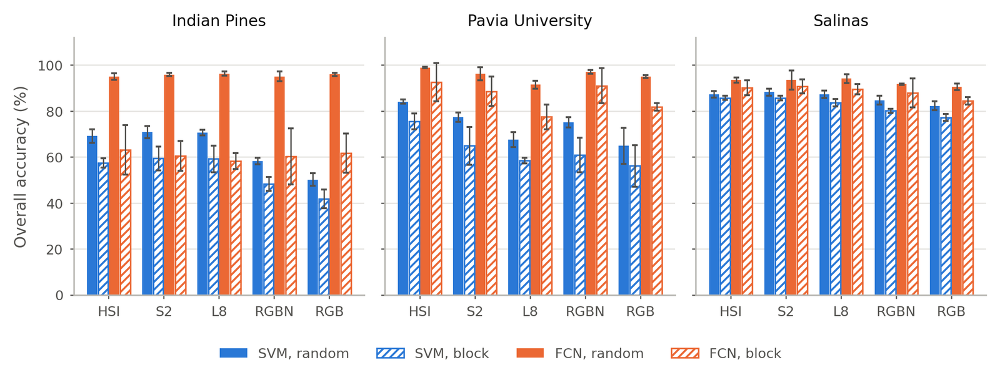
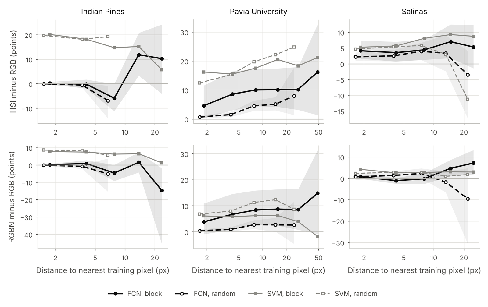
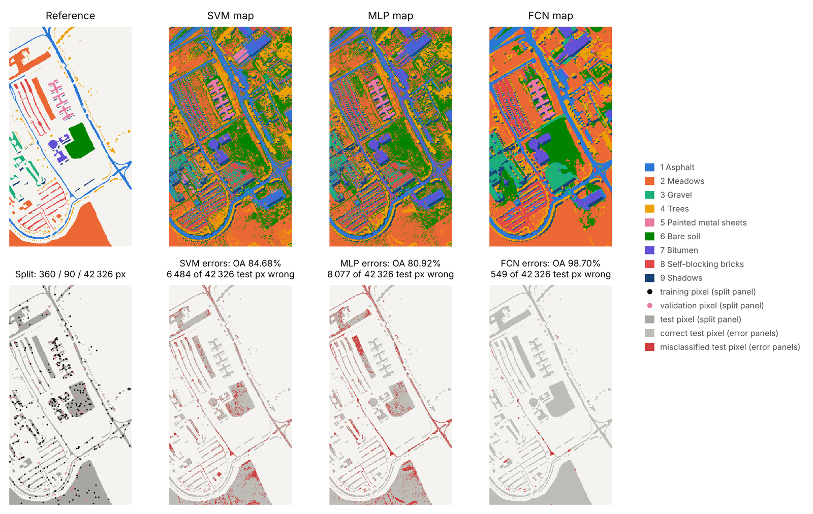
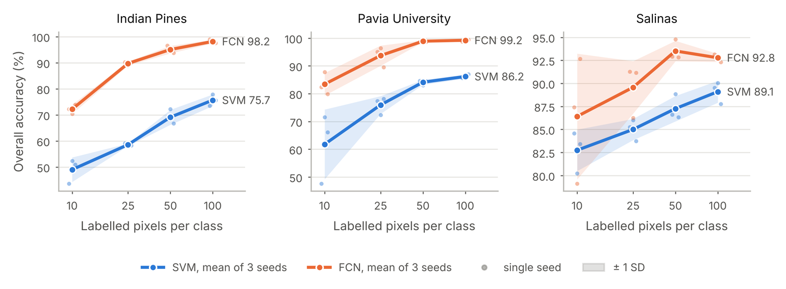

# HSI-LandCover

Land-cover classification of hyperspectral images with few labels, and a test of how much the hyperspectral bands
really add. From the Indian Pines, Pavia University and Salinas cubes we simulate Sentinel-2, Landsat-8, RGB+NIR and
RGB inputs, and compare a fully convolutional network (FCN) with an RBF-SVM under random and spatially separated
(block) splits, three seeds each.

## Main result

With random pixel splits, three RGB bands are almost as good as all hyperspectral bands. When test pixels lie away
from the training pixels (block split), the hyperspectral bands are clearly better.

FCN overall accuracy (%), mean of three seeds:

| Scene | Random, HSI | Random, RGB | Block, HSI | Block, RGB |
|---|---|---|---|---|
| Indian Pines | 95.1 | 95.9 | 63.1 | 61.7 |
| Pavia University | 98.9 | 95.0 | 92.5 | 81.8 |
| Salinas | 93.5 | 90.5 | 90.1 | 84.4 |



The gain from the hyperspectral bands grows with the distance between a test pixel and the nearest training pixel.
It is larger far from the training pixels than near them in 13 of 15 seed comparisons.



Pavia University, random split, seed 1: SVM 84.7%, MLP 80.9%, FCN 98.7% overall accuracy.



Accuracy against labelled pixels per class:



All numbers: [results/results.md](results/results.md).

## Run

```bash
pip install -r requirements.txt
bash scripts/get_data.sh               # Indian Pines, Pavia University, Salinas -> data/
bash scripts/run_paper.sh              # all experiments, then figures and tables in paper/
python scripts/distance_analysis.py    # accuracy against distance to the training pixels
```

On Google Colab, with a GPU runtime:

```python
!git clone https://github.com/vanithamagesh/HSI-LandCover.git
%cd HSI-LandCover
!pip install -q -r requirements.txt && bash scripts/get_data.sh
!bash scripts/run_paper.sh && python scripts/distance_analysis.py
```

One FCN run takes about a minute on a T4 GPU, and `run_paper.sh` trains 126 models (42 settings, 3 seeds).
Finished runs are skipped after a restart. To train on your own raster, see `python scripts/train_eval.py --help`.

## Code

```
hsilc/     data, sensor simulation, splits, FCN, SVM, training, evaluation
scripts/   get_data.sh, train_eval.py, run_paper.sh, paper_figures.py, distance_analysis.py, predict.py
tests/     smoke tests (pytest)
results/   figures and tables from our runs
```

`run_all.sh` also trains AnySensor, an experimental single model for any band layout. It did not match one FCN per
sensor and is not part of the results above.

## Licence

MIT for the code. The datasets are subject to the terms of their providers.
